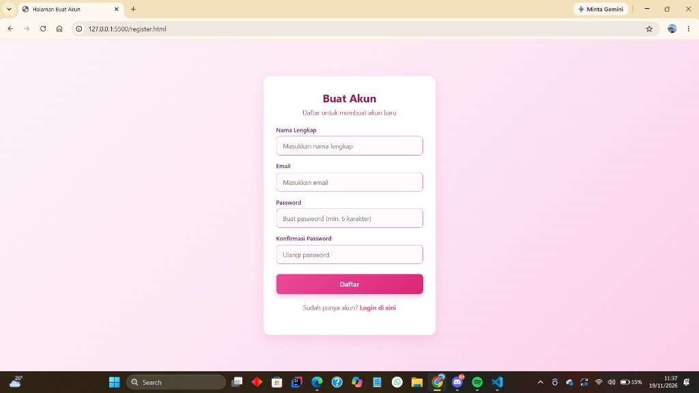
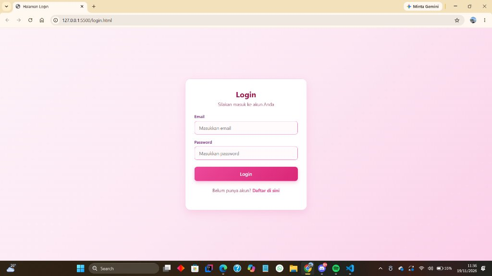
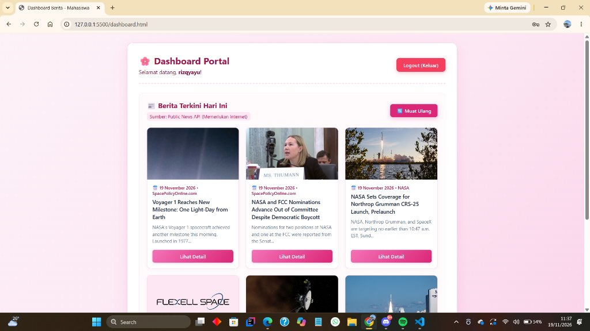
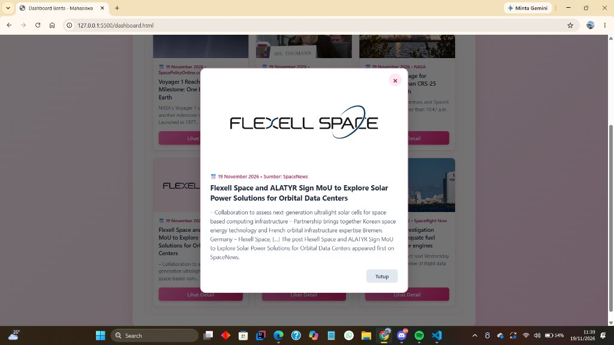

# 🌸 Tugas Pemrograman Web: Login, Register & Portal Berita (Public API)

Repositori ini berisi tugas praktikum Pemrograman Web yang mengimplementasikan sistem autentikasi sederhana (Login & Register) serta halaman Dashboard interaktif yang mengonsumsi data dari **Public API Berita secara real-time**. Proyek ini dibuat dengan tema warna **Pink pastel** yang bersih, modern, dan mudah dipahami.

---

## 📌 Fitur Aplikasi

### 1. 🔐 Sistem Autentikasi (Client-Side)
- **Registrasi Akun (`register.html`)**:
  - Input: Nama Lengkap, Email, Password, dan Konfirmasi Password.
  - Validasi format email (wajib memiliki karakter `@`).
  - Validasi panjang password minimal 6 karakter.
  - Validasi kesesuaian password & konfirmasi password.
  - Pengecekan email ganda (mencegah pendaftaran email yang sama).
  - Data akun disimpan di **`localStorage`** browser sehingga tidak hilang saat halaman di-refresh.
- **Login Akun (`login.html`)**:
  - Verifikasi kecocokan email dan password dari data `localStorage`.
  - Notifikasi interaktif (merah untuk error, hijau untuk sukses).
  - Menyimpan status user aktif ke dalam **`sessionStorage`** dan otomatis dialihkan ke Dashboard.

### 2. 🛡️ Proteksi Halaman Dashboard (`dashboard.html`)
- Hanya dapat diakses jika pengguna sudah login.
- Jika pengguna mencoba langsung membuka `dashboard.html` tanpa login, sistem otomatis mengalihkan (*redirect*) kembali ke `login.html`.
- Tombol **Logout** untuk menghapus sesi aktif dan kembali ke halaman login.

### 3. 📰 Integrasi Public API Berita & Pop-up Modal (`api.js`)
- Mengambil data berita publik terbaru secara langsung menggunakan fungsi bawaan **`fetch()`** JavaScript (asynchronous).
- **Bergantung pada Koneksi Internet**: Jika perangkat tidak terhubung ke internet (offline), sistem menampilkan pesan peringatan error yang rapi.
- **Pop-up Modal Detail**: Saat tombol *Lihat Detail* pada kartu berita diklik, detail lengkap berita akan muncul dalam jendela pop-up (*modal dialog*) tanpa mengalihkan pengguna ke luar website.
- Tombol **Muat Ulang** untuk me-refresh data berita secara manual.

---

## 📸 Tangkapan Layar (Screenshots)

| 1. Form Registrasi | 2. Form Login |
| :---: | :---: |
|  |  |

| 3. Dashboard Berita (Public API) | 4. Pop-up Modal Detail Berita |
| :---: | :---: |
|  |  |

---

## 🛠️ Teknologi yang Digunakan

- **HTML5**: Struktur semantik halaman web.
- **CSS3**: Desain antarmuka responsif dengan skema tema warna pink gradasi (*flexbox*, *css grid*, dan animasi modal).
- **Vanilla JavaScript**: 
  - Validasi form & manipulasi DOM.
  - Penyimpanan lokal via `localStorage` (daftar akun) & `sessionStorage` (sesi login aktif).
  - Pengambilan data publik via `fetch API`.
- **Public API**: [Spaceflight News API](https://api.spaceflightnewsapi.net/v4/articles/?limit=6) (Bebas CORS & tanpa API Key).

---

## 📂 Struktur Berkas

```text
├── login.html        # Halaman form login pengguna
├── register.html     # Halaman pendaftaran akun baru
├── dashboard.html    # Halaman dashboard portal berita
├── style.css         # Styling tema pink untuk seluruh halaman
├── script.js         # Logika autentikasi login & registrasi (LocalStorage)
├── dashboard.js      # Logika pengecekan sesi login & tombol logout
├── api.js            # Fetch data Public API berita & kontrol modal pop-up
└── README.md         # Dokumentasi proyek
```

---

## 🚀 Cara Menjalankan Proyek

Proyek ini tidak memerlukan instalasi backend server atau database (seperti Node.js, PHP, atau MySQL). Cukup jalankan langsung di browser:

### Opsi 1: Lewat VS Code Live Server (Direkomendasikan)
1. Buka folder proyek di **Visual Studio Code**.
2. Klik kanan pada berkas **`register.html`** atau **`login.html`**.
3. Pilih menu **"Open with Live Server"**.
4. Aplikasi akan otomatis terbuka di browser Anda (misalnya di `http://127.0.0.1:5500/`).

### Opsi 2: Buka Langsung di Browser
1. Buka File Explorer di laptop/komputer Anda.
2. Masuk ke folder proyek.
3. Klik ganda (*double click*) berkas **`register.html`** untuk langsung membukanya di browser (Google Chrome / Microsoft Edge / Firefox).

---

## 📝 Alur Pengujian Aplikasi

1. Buka **`register.html`** &rarr; Daftarkan akun baru Anda.
2. Setelah pendaftaran berhasil, Anda akan diarahkan ke **`login.html`**.
3. Masukkan email dan password yang baru dibuat &rarr; Klik tombol **Login**.
4. Anda akan masuk ke **`dashboard.html`** yang menampilkan sapaan nama Anda dan kartu berita terkini.
5. Klik tombol **Lihat Detail** pada kartu berita untuk melihat pop-up ringkasan.
6. Klik tombol **Logout** di pojok kanan atas untuk keluar dari akun.
